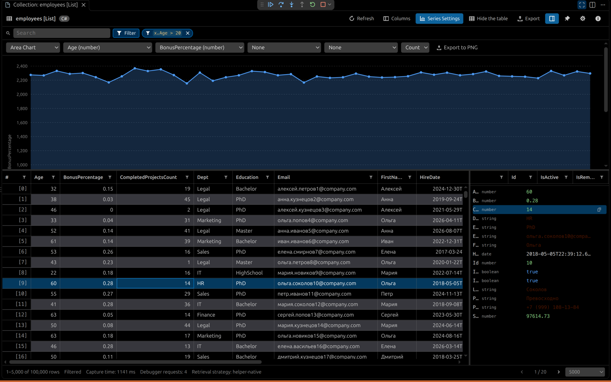

<div align="center">


# 🔍 Exploring Collections

**A database grade collection &amp; DataTable visualizer for the VS Code debugger — for C#, F#, JavaScript and TypeScript.**

Sort it, search it, filter it, chart it, export it — while your program sits at a breakpoint.

[](https://code.visualstudio.com/)
[](./LICENSE)
[](#-supported-languages)
[](#-charts)

*English · [Русский](./README.ru.md)*

</div>

<div align="center">



<sub>100 000 <code>List&lt;Employee&gt;</code> elements · condition <code>x.Age &gt; 20</code> · area chart · row details · the status bar reports the retrieval strategy, the request count and the capture time</sub>

</div>

---

## 🚀 Quick start

1. Install the extension from the Marketplace (or press `F5` in a clone of this repo).
2. Start a debug session in **any** supported language and stop at a breakpoint.
3. Hover the **Variables** view, **right-click a collection** → **🔍 Explore collection**.
4. Optionally, run the command **`Exploring Collections: Explore a Collection…`** from the Command Palette to pick any variable of the current frame.

| How to open it | Where |
| --- | --- |
| `🔍 Explore collection` | Right-click a variable in **Variables**, **Watch** or the **Call Stack** (`locals`) |
| `⌨️ Ctrl+Alt+E` / `⌘+Alt+E` | On any supported variable while debugging |
| `⌨️ Ctrl+Alt+Shift+E` | Command Palette picker with search over every visible variable |
| `🧭 Activity bar → Exploring Collections` | All captured snapshots, pinned or transient |
| `💡 Inline hint` | On the stopped line: `🔍 temperatures (14) · explore with Ctrl+Alt+E` |
| `🧪 Preview data` | CodeLens above a collection literal in the editor — **no debug session needed** |

### 🧪 No breakpoint? No problem

Data that is **hardcoded in the source** can be opened without debugging anything. Put the caret in a file that declares a collection literal, open the **Command Palette** → `Exploring Collections: Preview Collection Data from Source`, or simply click the `🧪 Preview data` CodeLens that appears above the literal:

```python
temperatures = [                                  # 🧪 Preview data · temperatures · 3
    {"city": "Seoul", "degrees": 21},
    {"city": "Busan", "degrees": 24},
    {"city": "Incheon", "degrees": 22},
]
```

The parser understands the literal syntax of the supported languages — JavaScript/TypeScript objects and arrays, C# `new List<T> { new T { … } }` and `new Dictionary<K,V> { ["k"] = v }`, F# record lists and JSON documents. Press `Ctrl+Alt+R` to re-read the literal after editing it.

---

## 🌍 Supported languages

Four languages, two capture strategies: **.NET is read only through the bundled helper** (one debugger request, whole page in one go), and **JavaScript/TypeScript is read from adapter previews**, falling back to the universal variables walk when an adapter hides the previews.

| Language | Adapters | Fast path | Native helper |
| --- | --- | --- | --- |
| **C#** | `coreclr`, `clr`, `vsdbg`, `dotnet` | helper file (1 request) | ✅ required — `ExploringCollections.Helper.dll` (also enables ADO.NET) |
| **F#** | `coreclr`, `clr`, `vsdbg`, `dotnet` | helper file (1 request) | ✅ required — same helper, option/union aware |
| **JavaScript / TypeScript** | `pwa-node`, `node`, `pwa-chrome`, `chrome`, `msedge`, `pwa-msedge`, `deno`, `bun` | adapter previews (1–2 requests) | built in |

✅ = bundled and used automatically

Column kinds (`number`, `string`, `boolean`, `date`, `null`, `object`, …) are inferred per language, so sorting and chart axes behave correctly in all of them.

---

## 📊 What you get

| Capability | Details |
| --- | --- |
| 🧮 **Data grid** | Virtualized rows, resizable columns, drag to reorder, hide/show, pagination with a free page size box and an **All (N)** entry, row count of every pipeline stage |
| 🧭 **Layout on your terms** | Hide the whole detail pane (or drag its splitter to any width), collapse the table, drag the splitter to change the chart/table ratio, and expand the view to the full editor width with the 🖥 button **left of *Split Editor Right*** in the editor title bar (`Exploring Collections: Toggle Full Width`) |
| 🌳 **Readable row details** | The detail pane aligns names, types and values in columns, indents nested members with guide lines, highlights the cell you clicked and copies any value from a hover button |
| 🔀 **Sorting** | Click any header; numbers/dates/booleans sort by kind, text sorts naturally (`2` before `10`), empty cells always last |
| 🔤 **Global search** | Case-insensitive substring across every visible column |
| 🔍 **Explore CodeLens** | An `Explore collection` lens above **the line that introduced each collection** — not above the breakpoint — with its element count, refreshed on every stop and step. When the identifier belongs to another file (a field, a generated member) the lens moves to the enclosing declaration instead of piling up on the stop line, and **Show Diagnostics** reports the exact line and reason for every lens |
| 🧪 **Design time preview** | A `Preview data` lens above collection literals, so hardcoded data can be inspected without a debug session — see [below](#-no-breakpoint-no-problem) |
| 🎯 **Local filters** | A funnel in every column header opens a per-column popup with a compact value box, an inline `/.*/ ` switch for regular expressions, `include`/`exclude` mode and the list of known values; `Clear all filters` removes every condition at once |
| 🧠 **Condition builder** | The `Filter rows with a condition` button next to the search builds a condition per column (contains, does not contain, equals, is not, starts with, ends with, matches the regular expression, greater/less/between, is null/empty/true/false) with a live expression preview. The condition runs over the captured rows, needs no debugger request and stays visible as a removable chip |
| 🌳 **Value pane** | Click `#` for the whole element, or any cell for that member only; nested members load lazily from the debugger |
| 📈 **Charts** | 9 chart types with series settings and PNG export |
| 💾 **Export** | CSV, JSON, Excel (`.xlsx`) and XML — containing the filtered and sorted view you are looking at |
| 📌 **Snapshots** | Pin a capture to keep exploring it after the session ends; reload it with the debugger gone |
| 🌐 **Localized** | English (primary) and Russian, both the manifest (`%key%`) and the runtime strings |
| 🧾 **Diagnostics** | Which strategy was used, how many adapter requests it cost, why a fast path was skipped, which collections the frame exposes right now, plus provider specific notes |

### 🔗 Locals in your filter

The **Filter rows with a condition** button next to the search collects the condition from per-column rows and keeps it visible as a chip with a clear button. The condition is evaluated locally over the rows that were captured, so applying it costs no debugger request and cannot block the debuggee. Free identifiers that are **not** columns are resolved in the current frame, just like a query parameter:

```text
x.Day == dayOfMonth        ← dayOfMonth is a local of the stopped statement
x.Price > budget * 1.2     ← budget too
```

---

## 📈 Charts

Nine chart types, `Show Chart` from the toolbar, `Series settings` in the corner:

| | | |
| --- | --- | --- |
| 📊 Bar | 🥧 Pie | 🌄 Area |
| 📈 Line | ⚬ Scatter | 🫧 Bubble |
| 🕯 Stock | ↕ AreaRange | 📶 Histogram |

Pick the **X axis**, a **Y series**, an optional **group** column (that is what turns one series into one series per group), a **bubble size** column, and an aggregation (`none`, `mean`, `sum`, `min`, `max`, `count`, `first`, `last`). Every chart can be exported to **PNG** for sharing without screenshots.

---

## 💾 Export

| Format | Extension | Notes |
| --- | --- | --- |
| CSV | `.csv` | RFC 4180 quoting, UTF-8 BOM so Excel opens it correctly, configurable delimiter/quote/line ending |
| JSON | `.json` | Typed values (`null`, numbers, booleans) plus capture metadata instead of display strings |
| Excel | `.xlsx` | A real spreadsheet with typed cells, frozen header row and auto width — written by our own ZIP/OOXML writer, no dependency |
| XML | `.xml` | One element per row, escaped and indented |

Copy to the clipboard as TSV with `Exploring Collections: Copy Rows`.

Exports contain **exactly the rows you see** — filters, search and sorting applied — and the extension tells you when a collection was truncated so a partial export is never silent.

---

## 🧰 Native helpers (bundled per language)

The bundled helpers are what make `.NET` ADO.NET collections and rich typed data work. They live in [`helpers/`](./helpers) — see [helpers/README.md](./helpers/README.md) for the full contract.

| Language | Helper | How to enable |
| --- | --- | --- |
| C# / F# | `ExploringCollections.Helper.dll` | **Automatic** — loaded into the process with `Assembly.LoadFrom` on first use |
| JavaScript / TypeScript | built in | Nothing to do |

Every helper speaks the same tiny envelope, so the extension needs one parser per language, not one per type:

```json
{ "__ec": 1, "kind": "sequence", "total": 14, "items": [ { "City": "Seoul" } ] }
```

`kind` is `sequence`, `mapping` (items are `[key, value]` pairs) or `record` (a single object). Limits, cycle detection and depth are handled inside the helper, so a cyclic graph yields a readable row rather than a hung debuggee. The helper writes a page to a temporary file that the extension reads and deletes, because a value returned from a method call is truncated by the adapter at about 1,000 characters. `.NET` collections therefore have **one** path: when the helper cannot be loaded or cannot write its file, the capture fails with an explanatory message instead of slowly walking thousands of variables. JavaScript/TypeScript never needs the helper and keeps the variables walk as its fallback.

---

## ⚙️ Settings

| Setting | Default | Description |
| --- | --- | --- |
| `exploringCollections.maxRows` | `10000` | Maximum number of elements to materialize per capture; set it to at least the collection size to see every row |
| `exploringCollections.captureBudgetMs` | `30000` | How long the JavaScript/TypeScript variables walk may spend reading a collection; what was read by then is shown as a truncated window. The fast paths (adapter previews, helper file) are not limited by this budget |
| `exploringCollections.pageSize` | `100` | Rows per page in the grid |
| `exploringCollections.maxDepth` | `3` | How deep nested members are flattened into columns |
| `exploringCollections.fetchConcurrency` | `8` | Parallel debug adapter requests while walking |
| `exploringCollections.timeoutMs` | `20000` | Per request timeout |
| `exploringCollections.enableCharts` | `true` | Show the chart tab |
| `exploringCollections.showInlineHints` | `true` | Inline `🔍 name (count)` hint on the stopped line |
| `exploringCollections.showCodeLens` | `true` | `Explore collection` CodeLens above every collection in scope at the breakpoint |
| `exploringCollections.showHoverLinks` | `true` | `Explore collection` link in the tooltip of collection variables in the stopped file |
| `exploringCollections.showDesignTimePreview` | `true` | `Preview data` CodeLens above collection literals, so hardcoded data can be opened without debugging |
| `exploringCollections.dateFormat` | `iso` | `iso`, `locale` or `raw` rendering of dates |
| `exploringCollections.columnOrder` | `alphabetical` | `alphabetical` or `discovery` (declaration) order |
| `exploringCollections.defaultExportFormat` | `csv` | Format pre-selected in the export dialog |
| `exploringCollections.exportDirectory` | *(workspace)* | Folder for exports |
| `exploringCollections.openExportedFile` | `true` | Open the file after exporting |
| `exploringCollections.dictionariesAsRows` | `true` | Render dictionaries as key/value rows instead of one wide row |
| `exploringCollections.customDebugTypes` | `{}` | Map extra debug type ids to a known family, e.g. `{ "my-runtime": "csharp" }` |
| `exploringCollections.excludedMembers` | `["Capacity","Count","Length","LongLength","_count","__len__"]` | Members never turned into columns |

---

## ⌨️ Commands

| Command | Keybinding | Purpose |
| --- | --- | --- |
| `Exploring Collections: Explore Collection` | `Ctrl+Alt+E` | Capture the variable under the cursor |
| `Exploring Collections: Explore Collection…` | `Ctrl+Alt+Shift+E` | Pick a variable from the frame |
| `Exploring Collections: Refresh Snapshot` | `Ctrl+Alt+R` | Re-read the same collection |
| `Exploring Collections: Preview Collection Data from Source` | | Open a collection literal without a debug session |
| `Exploring Collections: Toggle Full Width` | | Full editor width from the editor title bar |
| `Exploring Collections: Export Rows…` | | Export the current view |
| `Exploring Collections: Show Chart` | | Chart tab |
| `Exploring Collections: Copy Rows` | | Clipboard as TSV |
| `Exploring Collections: Pin Snapshot` | | Keep it after the session ends |
| `Exploring Collections: Remove Snapshot` | | Delete a stored snapshot |
| `Exploring Collections: Show Log` / `Show Diagnostics` | | Troubleshooting |

---

## 🌐 Localization

English is the primary language; Russian ships as the secondary one — for both the manifest (`package.nls.json` / `package.nls.ru.json`) and runtime strings (`l10n/bundle.l10n.json` / `l10n/bundle.l10n.ru.json`, 138 strings).

```bash
npm run l10n          # regenerate l10n/bundle.l10n.json + report missing translations
npm run l10n -- --check   # fail when a translated string is missing (CI)
```

To add a language: copy `l10n/bundle.l10n.ru.json` to `l10n/bundle.l10n.<tag>.json`, translate, add `package.nls.<tag>.json`, then run `npm run l10n -- --check`.

---

## 🏗️ How it works

```text
      capture request
            │
            ▼
  ┌───────────────────────┐
  │ 1. fast path          │   C#/F#: helper file (1 request, required)
  │                       │   JS/TS: adapter previews (1–2 requests)
  │ 2. variables walk     │   JS/TS fallback when previews are hidden
  └───────────────────────┘
            │
            ▼  language providers (syntax, column kinds)
  ┌───────────────────────┐
  │ snapshot + rows model │   immutable, serializable, exportable
  └───────────────────────┘
            │
            ▼  strict CSP webview (no framework, no runtime dependencies)
  grid · column filters · filter builder · 9 charts · value pane · export
```

```text
src/            extension host: providers, DAP client, filters, exports, commands
webview/        the UI (vanilla TypeScript, self contained SVG charts)
helpers/        per language helper libraries with their own test suites
test/           unit + integration tests (node:test over the bundled output)
resources/      icon and activity bar artwork
docs/           README screenshots (they ship with the VSIX so the Marketplace can show them)
scripts/        icon generation, l10n generation, helper test runner
```

Deliberate engineering choices: **no runtime dependencies** (own ZIP + XLSX writer, own SVG charts, own expression parser), **strict CSP** in the webview, **immutable snapshots** so a capture can be re-rendered after the session is gone, and **an AST based filter** so a condition is never rewritten by string surgery.

---

## 🛠️ Build from source

```bash
npm install
npm run build            # dist/extension.js + dist/webview.js
npm run check            # TypeScript 7 type check
npm test                 # unit tests + the .NET helper suite
npm run test:helpers     # helper suites only (skips toolchains you don't have)
npm run test:integration # drives the extension inside a real VS Code window
npm run preview          # renders the viewer into media/screenshot-*.png
npm run package          # produce exploring-collections-1.0.0.vsix
```

Helper build steps: `npm run package` packs the .NET helper assembly
(`helpers/dotnet/dist/ExploringCollections.Helper.dll` — one dll for both C# and F#) into the VSIX.
That assembly is tracked in git, so a fresh clone can be packaged as is; rebuild it with
`npm run build:helper:dotnet` after any change under `helpers/dotnet/`. The
JavaScript/TypeScript serializer is injected by the extension and needs no build step.
`npm run test:helpers` runs the .NET helper suite, skipping the run when the toolchain is missing;
the build and test commands are in [helpers/README.md](./helpers/README.md).

`npm run test:integration` launches the installed Visual Studio Code with a throwaway
profile, starts a real Node debug session on a sample program and checks the CodeLens,
the hover link, the capture pipeline and the panel — including screenshots of the DOM
through the headless preview renderer (`npm run preview`).

Requires Node.js 20+ (developed against Node 26), TypeScript 7 and, for the .NET helper suite, a .NET SDK.

---

## 📄 License

**MIT** — full text in [LICENSE](LICENSE). © 2026 Dmitry Sorokin (dimanrus).